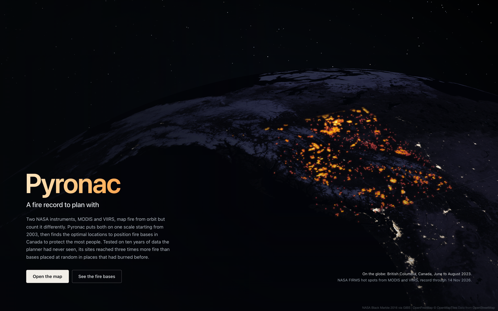
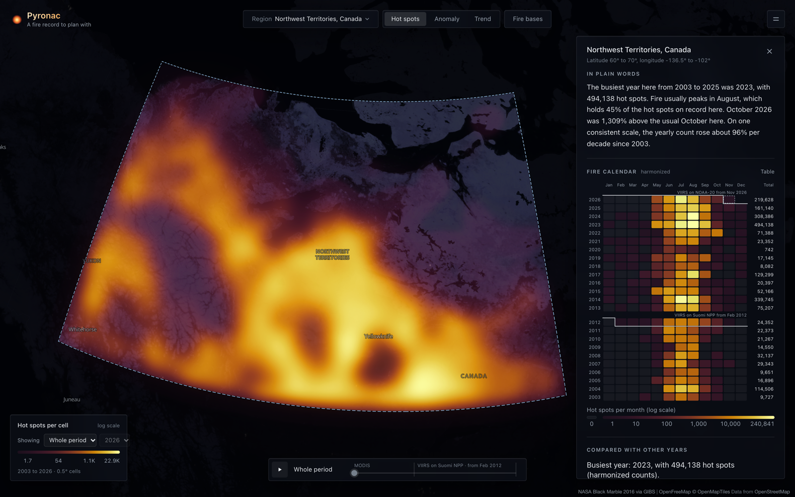
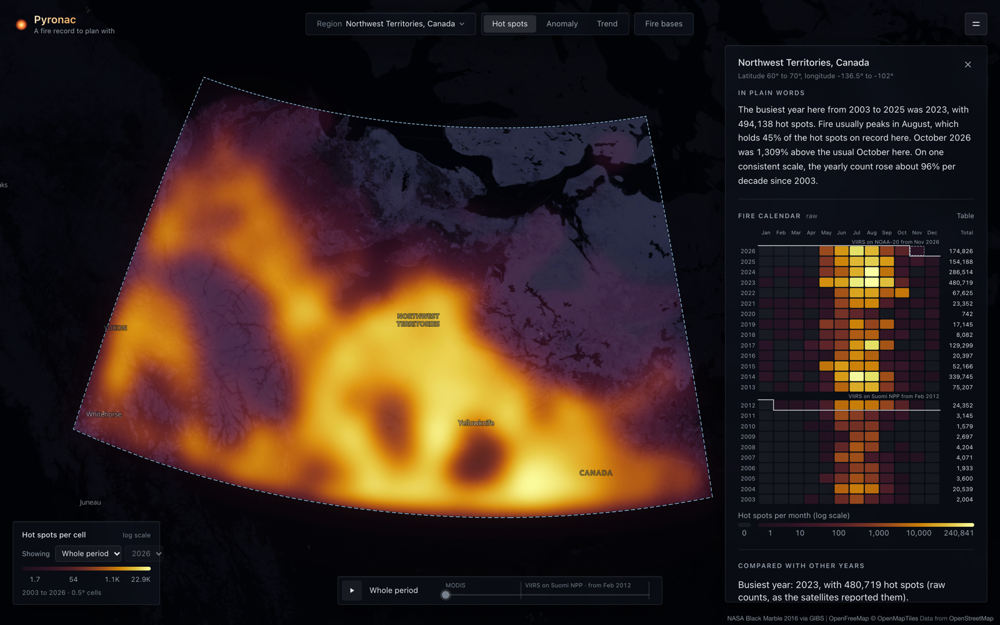
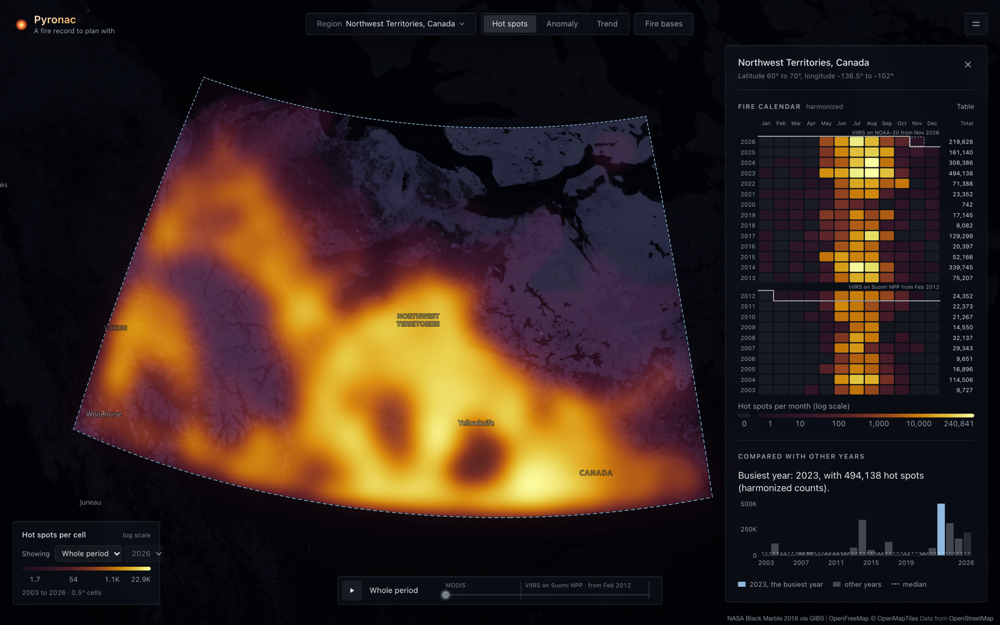
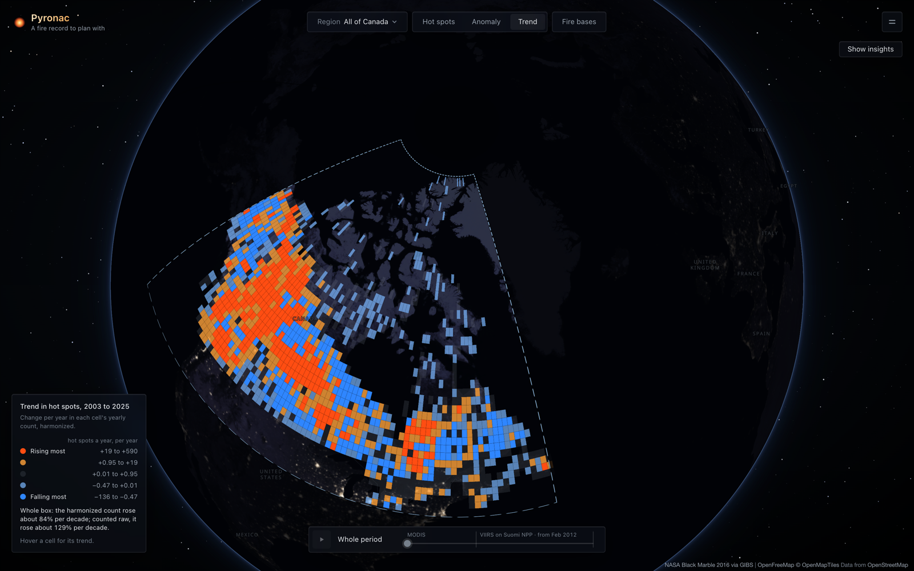
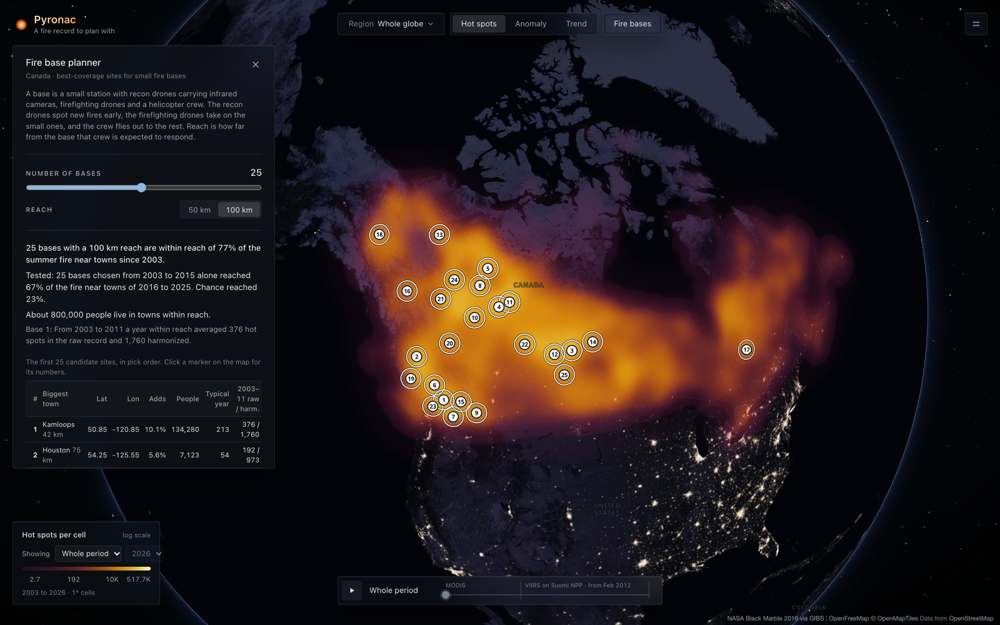
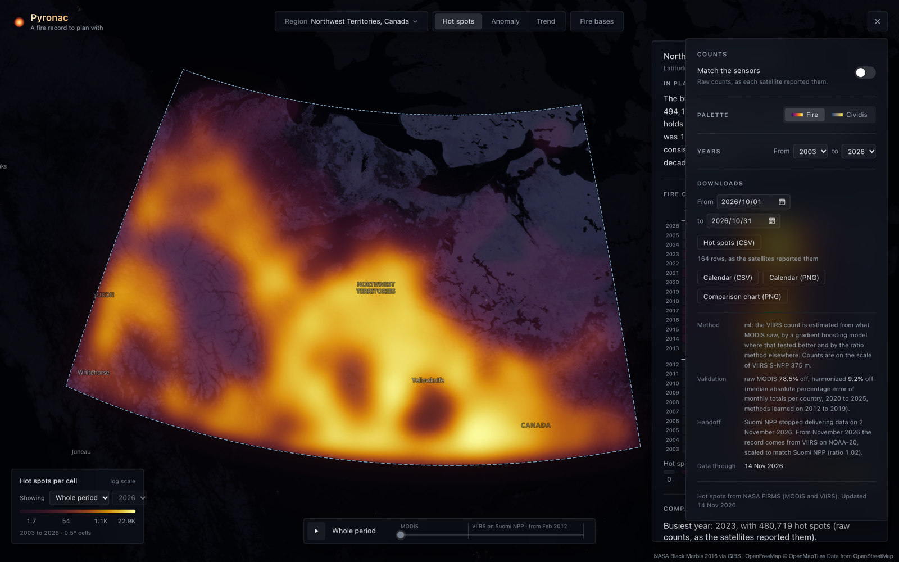
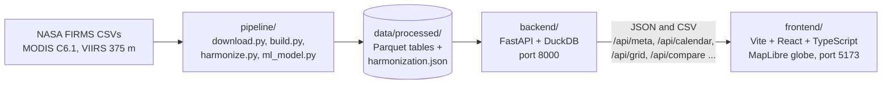

# Pyronac, a fire record to plan with

[](https://www.spaceappschallenge.org/)
[](https://firms.modaps.eosdis.nasa.gov/)
[](https://www.python.org/)
[](https://vite.dev/)



**One consistent fire record for Canada, northern India and the Amazon, from 2003 to this month,
built from two NASA satellite instruments that count fire differently.**

NASA FIRMS MODIS and VIIRS hot spots, harmonized to the Suomi NPP VIIRS scale, in a web app for
emergency managers. Built for the NASA Space Apps Challenge 2026, Toronto.

## The problem

Satellites record fires as "hot spots". **MODIS** (Terra and Aqua, since 2000) has pixels about
1 km across. **VIIRS** (Suomi NPP since 2012, then NOAA-20) has 375 m pixels, sees smaller fires and
reports several times more hot spots for the same fire: over the years both flew, Suomi NPP reported
5.74 hot spots for every MODIS hot spot over Canada, 5.65 over India and 3.79 over Brazil.

So if you count MODIS hot spots before 2012 and VIIRS after, every fire record jumps in 2012 for no
reason on the ground. A planner looking at a 20-year chart sees a false rise. Pyronac removes that
jump so the sensor of origin no longer matters, and treats the second handoff the same way: Suomi NPP
stopped delivering data on 2 November 2026, and the record continues on NOAA-20.

## What it does

| | |
|---|---|
|  |  |
| **Pick an area, read its fire history.** Choose a preset or draw a box on the globe. A plain-words summary (from a fixed template, not an AI model) and a calendar of every month from 2003 to now, one row per year. | **Flip to raw and watch the false jump appear.** In the Northwest Territories, 2011 reads 22,373 hot spots harmonized and 3,145 raw. From February 2012 both records are the Suomi NPP count. |
|  |  |
| **Compare with other years.** A chosen month or year against the median and usual range for that area, with a sentence such as how far above the usual October it is. | **Trend and anomaly maps.** Each cell coloured by its change per year (2003 to 2025) or by how unusual the selected month is. Over all of Canada the harmonized count rose about 84% per decade; counted raw, about 129%. |
|  |  |
| **Fire base planner.** Candidate sites in Canada for small fire bases, chosen from the harmonized summer hot spots near towns. Chosen on 2003 to 2015 alone, 25 sites with a 100 km reach covered 67% of the fire near towns in 2016 to 2025, against 23% for random fire sites. Candidates to study, not a forecast: the record does not know roads, water or land cover. | **Downloads and the method on screen.** Hot spots as CSV, the calendar as CSV or PNG, the comparison chart as PNG, a one-page printable briefing, a colour-vision-safe palette and a time-lapse through every month. |

## How the harmonization works

The reference scale is VIIRS on Suomi NPP. `harmonized_count` answers: *how many hot spots would
Suomi NPP have reported for this cell in this month?*

- **2003 to January 2012 (MODIS only).** For Canada, a gradient boosting model estimates the Suomi
  NPP count of each cell and month from what MODIS saw (counts, fire radiative power, neighbouring
  cells, day and night, Terra and Aqua). For India and Brazil, a Suomi NPP to MODIS ratio per 1 degree
  block and calendar month, which tested better there.
- **February 2012 to October 2026.** The Suomi NPP count itself, with the days Suomi NPP recorded
  almost nothing filled from NOAA-20.
- **From November 2026.** The NOAA-20 count times a handoff ratio learned over April 2018 to
  October 2025, when both flew: 1.023 for Canada, 0.993 for India, 1.029 for Brazil.

**Validation.** Methods learned on 2012 to 2019 only, then tested on 2020 to 2025 against what
Suomi NPP actually reported (median absolute percentage error):

| | Monthly totals | Yearly totals |
|---|---|---|
| Raw MODIS, nothing done | 78.5% off | |
| **Pyronac, all three countries** | **9.2% off** | **2.6% off** |
| Canada (model) | 14.8% | 1.3% |
| India (ratio method) | 10.0% | 2.5% |
| Brazil (ratio method) | 5.2% | 5.3% |

The full method, the versions we tried and dropped, and the limits are in
[docs/METHOD.md](docs/METHOD.md).

## Data

NASA FIRMS active fire data, exactly:

- [FIRMS MODIS Collection 6.1](https://firms.modaps.eosdis.nasa.gov/) active fire data (Terra and Aqua), 2003 to 14 November 2026
- [FIRMS VIIRS 375 m](https://firms.modaps.eosdis.nasa.gov/) active fire data from Suomi NPP (20 January 2012 to 2 November 2026) and NOAA-20 (April 2018 to 14 November 2026)

Canada, India and Brazil; 42,742,826 detections in the final build. Basemap: NASA Black Marble via
GIBS, with labels from OpenFreeMap, OpenMapTiles and OpenStreetMap. Town list for the base planner:
GeoNames. Details in [docs/DATA_NOTES.md](docs/DATA_NOTES.md).

## Architecture



Plain Python scripts and DuckDB build Parquet files on disk; there is no database server. The
backend reads them read-only; the frontend calls it through the Vite proxy. The contracts between
the parts are in [MASTERSPEC.md](MASTERSPEC.md).

## Quickstart

You need Python 3.11 or newer and Node.js 20 or newer.

### 1. Get the data

Real data is not in git. Download the processed tables from the
[final data release](https://github.com/andrewl746/pyronac/releases/tag/data-3-countries-2003-2026-final-20261114)
and extract them into `data/processed/`, so that `data/processed/grid.parquet` exists:

```sh
gh release download data-3-countries-2003-2026-final-20261114 -R andrewl746/pyronac -D data/
unzip data/pyronac-canada-india-brazil-2003-2026-final.zip -d data/processed/
```

Raw FIRMS CSVs are on the [earlier release](https://github.com/andrewl746/pyronac/releases/tag/data-canada-2003-2025-20261114).
Without any download, the backend runs on the small fake set in `data/fixtures/` and the app shows
a "Test data" tag.

### 2. Run the app

```sh
# Backend, from the repo root
python3 -m venv .venv
source .venv/bin/activate            # Windows: .venv\Scripts\activate
pip install -r backend/requirements.txt -r pipeline/requirements.txt
cd backend
uvicorn app.main:app --reload --port 8000
# Check http://localhost:8000/api/health and the API docs at http://localhost:8000/docs

# Frontend, in a second terminal
cd frontend
npm install
npm run dev
# Open http://localhost:5173
```

The backend uses `data/processed/` if `data/processed/grid.parquet` exists, otherwise
`data/fixtures/`. Set `FIRE_DATA_DIR` to force a folder. Backend tests: `cd backend && pytest`.

### 3. Build the tables yourself (optional)

```sh
source .venv/bin/activate
python pipeline/make_fixtures.py
python pipeline/build.py --fixtures          # fake data -> data/fixtures/
python pipeline/download.py --country canada --years 2003-2025 --sources modis,viirs-snpp
python pipeline/download.py --country canada --years 2018-2025 --sources viirs-jpss1
python pipeline/build.py                     # real data -> data/processed/
```

The yearly country files for 2003 to 2025 are public and need no key. Downloads skip files that
already exist and are not empty, and an interrupted download is left as a `.part` file that never
looks complete. The 2026 files need a signed-in FIRMS archive request: see section 5.1 of the
master spec. Check the downloader with `cd pipeline && python -m unittest test_download`.

## Team

Andrew L, Vlad, Yuvi, Andrew N, Angela and Sam, at the NASA Space Apps Challenge 2026, Toronto.
Who built which part is in section 4 of [MASTERSPEC.md](MASTERSPEC.md).

## AI use

The hackathon rules ask teams to show where and how AI tools were used. Every AI-assisted session,
what it produced and how a person checked it is recorded in [docs/AI_USE.md](docs/AI_USE.md). The
method and the decisions are the team's.

## More

- [MASTERSPEC.md](MASTERSPEC.md): the project spec, contracts and task sheets
- [docs/METHOD.md](docs/METHOD.md): the harmonization method, validation and the base planner
- [docs/DATA_NOTES.md](docs/DATA_NOTES.md): where the data comes from and how it was cleaned
